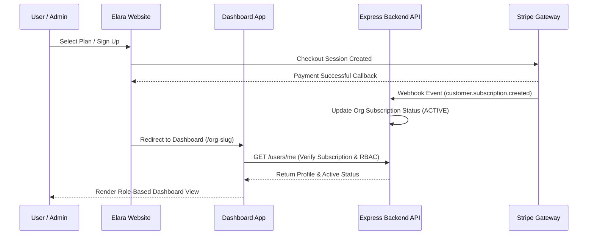

# Elara / Employee Recognition Dashboard

A modern, role-based Employee Recognition & Rewards Management Platform built with Next.js 16 (App Router), React 19, TypeScript, Redux Toolkit, and Tailwind CSS.

---

## 🔒 Security & Architecture Overview

The system operates across four primary components:
1. **Landing Website (`https://elara.com`)**: Public marketing, pricing, registration, and user authentication portal.
2. **Dashboard Application (`https://dashboard.elara.com`)**: Multi-tenant client dashboard for Super Admin, Organization Admin, Department Admin, and Employee users.
3. **Backend API (`https://api.elara.com/api/v1`)**: Node.js/Express REST API enforcing Role-Based Access Control (RBAC), organization isolation, database audit logs, and session management.
4. **Stripe Billing Integration**: Handles subscription plans, payment processing, upgrade events, and status sync via webhooks.

### Security Best Practices
- **Token Management**: Authentication tokens are passed via `HttpOnly`, `Secure`, and `SameSite=Lax` cookies. Readable sensitive tokens are removed from URL query parameters.
- **Cross-Organization Isolation**: Every request is verified by backend middleware against user role, organization ID, department, and resource ownership.
- **High-Impact Deletions**: Deleting organization accounts or employee accounts requires double-confirmation (`DELETE` keyword validation) and maintains audit log entries.
- **Clean Storage**: Logout purges only Elara-related browser storage keys (`user`, `token`, `refreshToken`, `accessToken`, `persist:auth`).

---

## 🛠️ Tech Stack

- **Framework**: [Next.js 16](https://nextjs.org/) (App Router, Turbopack)
- **UI & Styling**: [React 19](https://react.dev/), [Tailwind CSS v4](https://tailwindcss.com/), [Shadcn UI](https://ui.shadcn.com/), [Radix UI](https://www.radix-ui.com/), [Framer Motion](https://www.framer.com/motion/)
- **State Management**: [@reduxjs/toolkit](https://redux-toolkit.js.org/), `redux-persist`
- **Data Table & Forms**: [@tanstack/react-table](https://tanstack.com/table/v8), `react-hook-form`, `zod`
- **Notifications**: `sonner`, `react-toastify`
- **Icons**: `lucide-react`

---

## 🌐 Environment Variables & Local Setup

### Environment Variables
Copy `.env.example` to `.env.local` for local development:

```env
# Backend API Base URL
NEXT_PUBLIC_BASE_URL="https://api.elara.com/api/v1"

# Main Elara Website URL
NEXT_PUBLIC_WEBSITE_URL="https://elara.com"

# Dashboard URL
NEXTAUTH_URL="https://dashboard.elara.com"
```

### Local Ports Configuration

| Service | Local URL / Port | Environment |
|---|---|---|
| **Dashboard** | `http://localhost:3010` | Development |
| **Website / Landing** | `http://localhost:3041` | Development |
| **Backend API** | `http://localhost:7000/api/v1` | Development |

---

## ⚙️ Development & Build Commands

```bash
# 1. Install dependencies
npm install

# 2. Run local development server (Port 3010)
npm run dev

# 3. TypeScript type check
npx tsc --noEmit

# 4. ESLint check
npm run lint

# 5. Production build
npm run build

# 6. Start production server
npm run start
```

---

## 🚀 CI/CD Pipeline & Deployment

Automated checks trigger on every push and pull request via `.github/workflows/ci.yml`:
1. **Secret Scanning**: Verifies no `.env.local` or sensitive key files are committed.
2. **ESLint & TypeScript Typecheck**: Enforces zero code style and typing errors.
3. **Production Build Check**: Ensures clean compilation before deployment.

### Deployment Steps
1. Push committed code to `main` branch after passing CI checks.
2. Server triggers deployment runner (`pm2 restart elara-dashboard` or container rebuild).
3. Validate health endpoint at `https://dashboard.elara.com/api/health` or home route.

---

## 🔄 Backups & Rollback Procedures

### Pre-Deployment Backup
Before deploying a new release to production:
- Create a Git release tag: `git tag -a v1.x.x -m "Release v1.x.x" && git push origin v1.x.x`
- Backup server environment configuration: `cp .env.production .env.production.bak_$(date +%Y%m%d)`

### Instant Rollback Procedure
If issues arise in production:
1. Revert to previous stable tag:
   ```bash
   git checkout v1.x.x-previous
   npm install
   npm run build
   pm2 restart elara-dashboard
   ```
2. Verify system functionality on `https://dashboard.elara.com`.

---

## 💳 How Website, Dashboard, Backend & Stripe Work Together



---

## 📜 License

Elara Private Repository - All rights reserved.
